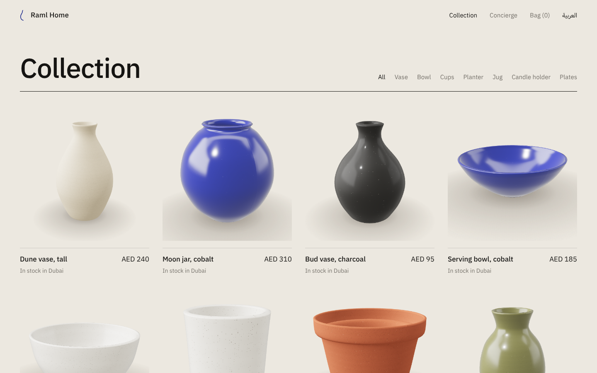

# Grounded Concierge

**A bilingual ceramics store whose AI concierge can only say what the live catalogue says, and proves it on every reply.**

Shopping assistants that make up a price or promise stock that does not exist cost more than they save. This project shows the other way: the assistant is connected to the store's real data through tools, it is told to state nothing it did not look up, and then the page checks its answer. Every price, stock count and SKU in a reply is matched against the tool results from that same turn. Anything that does not match is hidden and the reply says so.


## The store

*Raml Home* is a fictional ceramics studio in Al Quoz, Dubai. Its one idea runs through the whole site: **every piece is a single profile line turned on a wheel.** The products are not photographs. Each one is rendered live in 3D (three.js) from its profile curve, in the glaze it is fired in, and the profile itself appears beside the object. Drag any piece to turn it.

- Collection, product and concierge views, English and Arabic with full right-to-left layout
- Stock by emirate (Dubai, Abu Dhabi, Sharjah), stamped with the time of the last ERP sync
- Product cards inside the chat, a bag, and a demo checkout



## The concierge

Inside Claude, the concierge runs on the viewer's own Claude account with three tools:

| Tool | Returns |
|---|---|
| `search_products` | Products by kind, glaze, price range and emirate stock |
| `get_product` | One SKU with price, size, set size and stock by emirate |
| `get_policy` | Delivery, returns, pickup and care text |

Rules it works under: call tools before stating facts, say "I don't know" and offer the studio team when the tools cannot answer, cite every product by SKU, reply in the customer's language.

**Grounding check** (`groundingCheck` in `src/concierge.js`): after each reply, every AED amount, stock count and SKU is matched against that turn's tool results, in English and Arabic numerals. The reply shows how many facts were checked against how many lookups. Unverified details are removed before display.

Outside Claude (for example on GitHub Pages) the page falls back to a catalogue search mode that uses the same retrieval and the same grounding check, without a language model.

## Run it

No dependencies. Node 18 or later.

```bash
npm test          # 7 tests: retrieval, tools, grounding (English and Arabic), offline answers
npm run build     # writes dist/index.html, one self-contained file including three.js and fonts
```

## Structure

```
src/catalog.js    products, profiles, glazes, stock, policies, search
src/concierge.js  tools, rules, grounding check, offline responder
src/stage.js      profile to 3D: lathe geometry, glaze textures, studio lighting
src/app.js        storefront, routing, bilingual UI, chat
test/             node:test suite
```

## Author

Lana Alzoubi · AI & Automation · [lanaalzoubi.com](https://lanaalzoubi.com)

MIT License. Demo store: Raml Home is a fictional company. three.js is MIT licensed.
