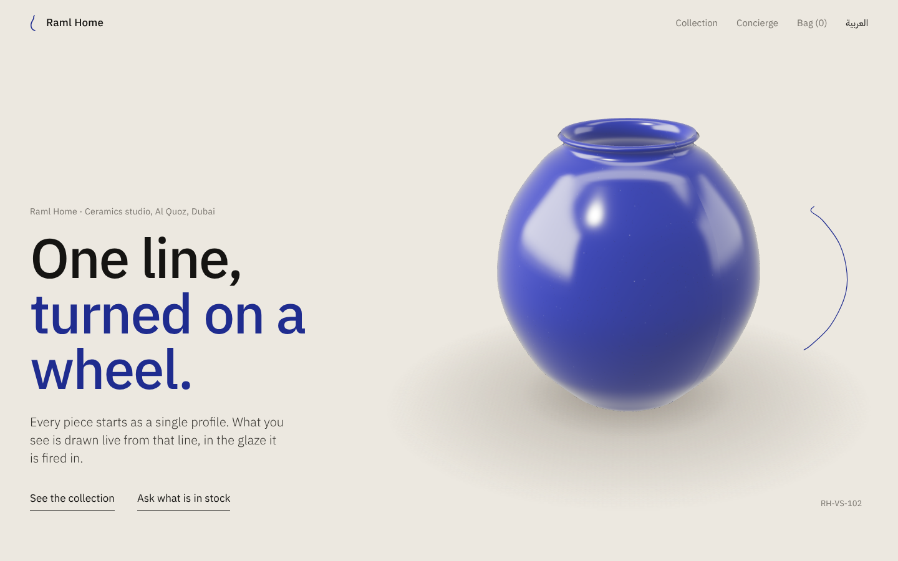
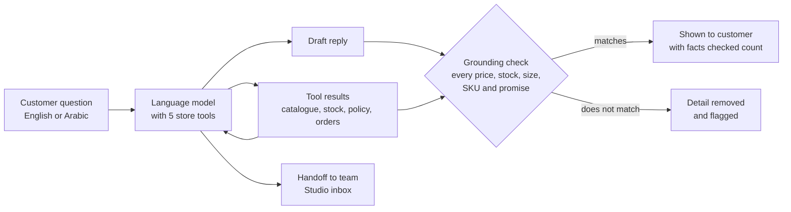

# Grounded Concierge

**A bilingual ceramics store with an AI concierge that checks its replies against the live catalogue before the customer sees them.**

[](https://lanaalzoubi521-lab.github.io/grounded-concierge/) [](https://github.com/lanaalzoubi521-lab/grounded-concierge/actions/workflows/test.yml)   

**[Open the live demo →](https://lanaalzoubi521-lab.github.io/grounded-concierge/)** A working store in English and Arabic. Nothing to install.

Shopping assistants that make up a price or promise stock that does not exist cost more than they save. This project shows the other way: the assistant is connected to the store's real data through tools, it is told to state nothing it did not look up, and then the page checks its answer. Every price, stock count and SKU in a reply is matched against the tool results from that same turn. Anything that does not match is hidden and the reply says so.



## The store

*Raml Home* is a fictional ceramics studio in Al Quoz, Dubai. Every piece is a single profile line turned on a wheel, so the products are rendered live in 3D (three.js) from that line, in the glaze they are fired in. Drag any piece, or use the arrow keys, to turn it.

- Categories, filters (type, glaze, price, stock by emirate), sorting and search
- Product page with three angles, stock and delivery for the chosen emirate, a quantity capped by real stock, and delivery and care details from the store policy
- Bag with quantities capped by stock and the delivery fee calculated from the policy
- English and Arabic with full right-to-left layout


## The concierge

With a language model connected (the hosted version runs on Claude, on the viewer's own account), the concierge has five tools:

| Tool | What it does |
|---|---|
| `search_products` | Products by kind, glaze, price range and stock per emirate |
| `get_product` | One SKU with price, size, set size and stock by emirate |
| `get_policy` | Delivery, returns, pickup and care text |
| `get_order_status` | Order status, released only when the order number and the last four phone digits both match |
| `handoff_to_team` | Opens a request for the studio team, shown in the Studio inbox |

**Grounding check** (`groundingCheck` in `src/concierge.js`): every price, stock count, size, percentage and SKU in a reply is tied to the product named in the same sentence and compared with that turn's tool results, in Latin, Arabic and Persian digits. Promise words (discounts, coupons, gifts, half price) are flagged unless negated. The reply is shown only after it passes; failed details are removed at their exact position, and each reply shows how many facts were checked against how many lookups.

**Handoff.** When the concierge cannot help, or a customer asks for a person, it collects a name, contact and question and opens a request. The demo shows these in a Studio inbox; in production they would go to a CRM or WhatsApp.

The public demo on GitHub Pages runs without a model: it uses catalogue search with the same retrieval, order verification and grounding check, without a language model. See [SECURITY.md](SECURITY.md) for how the concierge is protected.

## How it fits together



## Built with

Vanilla JavaScript (ES modules) · three.js (lathe geometry from profile curves, PBR glazes) · LLM tool calling · bilingual RTL layout · `node:test` · GitHub Actions CI

## Run it

No dependencies. Node 18 or later.

```bash
npm test          # 22 tests: retrieval, tools, grounding in English and Arabic, promise guard, order verification and lockout, handoff
npm run build     # writes dist/index.html, one self-contained file including three.js and fonts
```

## Structure

```
src/catalog.js    products, profiles, glazes, stock, policies, search
src/concierge.js  tools, rules, grounding check, offline responder
src/stage.js      profile to 3D: lathe geometry, glaze textures, studio lighting
src/app.js        storefront, routing, bilingual UI, chat
test/             node:test suite
```

## Author

Lana Alzoubi · AI & Automation · [lanaalzoubi.com](https://lanaalzoubi.com)

© 2026 Lana Alzoubi. All rights reserved. The code is published for review; reuse needs written permission. See [LICENSE](LICENSE). Demo store: Raml Home is a fictional company.
